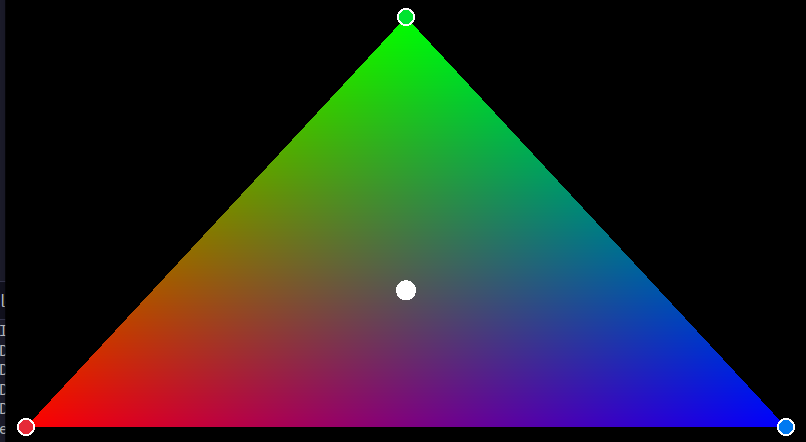
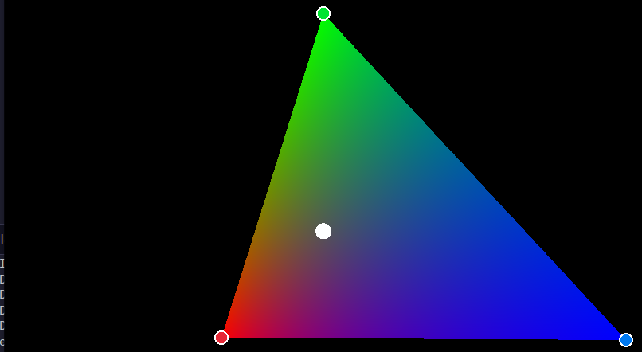
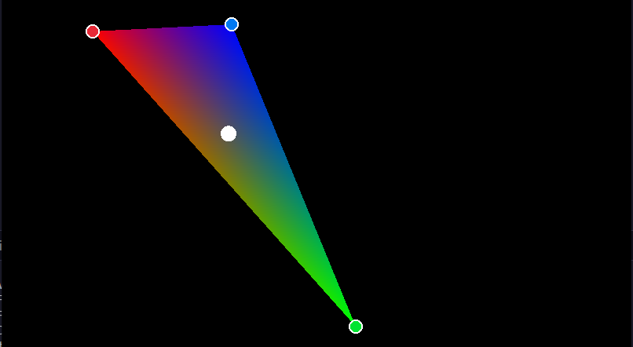

# Triangulo baricentrico

Implementacion en Zig y Raylib de rasterizacion de triangulos mediante coordenadas baricentricas, interpolando los colores Rojo, Verde y Azul asignados a cada vertice con manipulacion interactiva en tiempo real.

## Imagenes

### Triangulo 1 


### Triangulo 2 


### Triangulo 3 


---

## Algoritmos

### 1. Funcion de borde 2D
Calcula el producto cruz en 2D entre la arista P1 -> P2 y el punto P3, equivalente al doble del area con signo:

```text
E(P1, P2, P3) = (P2.x - P1.x) * (P3.y - P1.y) - (P2.y - P1.y) * (P3.x - P1.x)
```

El area total del triangulo corresponde a:

```text
Area_Total = E(A, B, C)
```

### 2. Coordenadas baricentricas (w_A, w_B, w_C)
Para cualquier punto en pantalla, sus coordenadas baricentricas corresponden a la proporcion entre el area del subtriangulo opuesto y el area total:

```text
w_A = E(B, C, P) / Area_Total    (Peso del Vertice A / Rojo)
```
```text
w_B = E(C, A, P) / Area_Total    (Peso del Vertice B / Verde)
```
```text
w_C = E(A, B, P) / Area_Total    (Peso del Vertice C / Azul)
```

Un punto pertenece al interior del triangulo si y solo si todas sus coordenadas son no negativas:

```text
w_A >= 0 and w_B >= 0 and w_C >= 0
```

### 3. Modulacion de proporcion con el punto p
El punto blanco P actua como el centro neutral de interpolacion (donde los tres colores se equilibran en partes iguales). A partir de las coordenadas baricentricas de P (p_A, p_B, p_C), se calcula un factor de escala inverso:

```text
scale_A = (1.0 / 3.0) / p_A
```
```text
scale_B = (1.0 / 3.0) / p_B
```
```text
scale_C = (1.0 / 3.0) / p_C
```

Para cada pixel dentro del triangulo se ponderan los pesos y se normalizan:

```text
W_A = w_A * scale_A
```
```text
W_B = w_B * scale_B
```
```text
W_C = w_C * scale_C
```
```text
Total = W_A + W_B + W_C
```
```text
Rojo  = (W_A / Total) * 255
```
```text
Verde = (W_B / Total) * 255
```
```text
Azul  = (W_C / Total) * 255
```

* En el baricentro geometrico (A + B + C) / 3, todas las escalas son 1.0, produciendo el degradado baricentrico estandar.
* Al alejar P de un vertice hacia el lado opuesto, el color de ese vertice se extiende hacia P.

### 4. Bounding box 
Para optimizar el rendimiento, el recorrido de pixeles se restringe a la caja delimitadora del triangulo:

```text
min_x = max(0, floor(min(A.x, B.x, C.x)))
```
```text
max_x = min(ancho - 1, ceil(max(A.x, B.x, C.x)))
```
```text
min_y = max(0, floor(min(A.y, B.y, C.y)))
```
```text
max_y = min(alto - 1, ceil(max(A.y, B.y, C.y)))
```

## Ejecucion

```bash
zig build run
```
